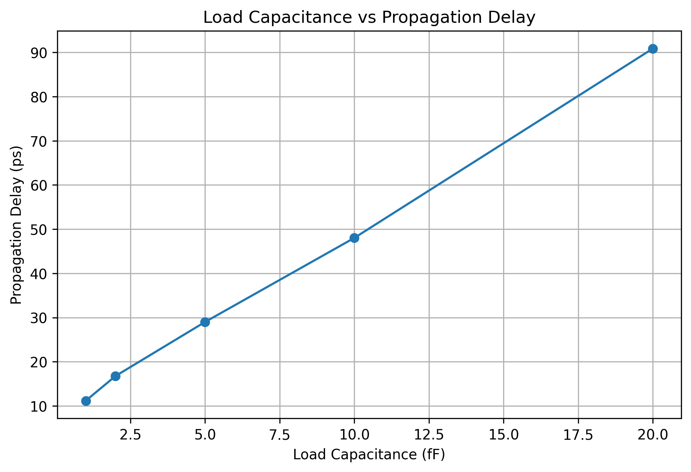
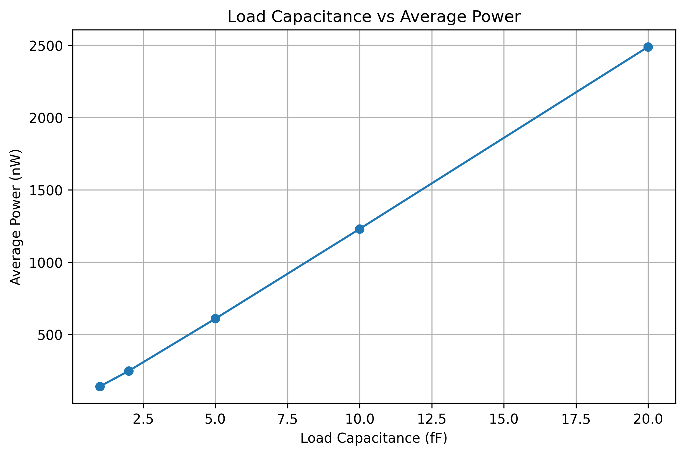

# Circuit Simulation & Analysis

Hands-on CMOS circuit simulation, timing/power analysis, and Python-assisted data visualization by an Electrical Engineering student at **San Francisco State University**.

This repository documents simulation exercises and technical learning related to digital integrated circuits. It is a personal project portfolio, **not** a release of proprietary lab designs or a complete semiconductor process design kit.

## Featured Project: CMOS Inverter Characterization

**[View full experiment, measurements, and plots](hspice/cmos-inverter/README.md)**

Investigated how output load capacitance affects a CMOS inverter's propagation delay and average power consumption using **Synopsys HSPICE** and **WaveView**. Subsequently used a Python-based simulation workflow to sweep load capacitances, export measurements, and plot results.

**Automated sweep results:**

| Load | Average Power | Propagation Delay |
|---:|---:|---:|
| 1 fF | 141.48 nW | 11.16 ps |
| 2 fF | 248.40 nW | 16.77 ps |
| 5 fF | 609.32 nW | 29.00 ps |
| 10 fF | 1,230.00 nW | 48.03 ps |
| 20 fF | 2,489.30 nW | 90.89 ps |

**Observation:** Under these simulated conditions, both average power and propagation delay increased as load capacitance increased.





## Tools & Skills

- **Circuit simulation:** Synopsys HSPICE, transient simulation, SPICE measurement commands
- **Waveform analysis:** Synopsys WaveView, propagation delay and switching behavior
- **Automation and analysis:** Python, CSV processing, Matplotlib
- **Environment:** Linux command line, Git and GitHub

## Repository Contents

- `hspice/cmos-inverter/README.md` — experiment setup, methodology, measurements, validation, and limitations
- `hspice/cmos-inverter/analysis/plot_results.py` — script to regenerate the power/delay plots from the included CSV
- `hspice/cmos-inverter/results/` — exported simulation measurements
- `hspice/cmos-inverter/images/` — visualization and waveform comparison

To regenerate the two data plots (Python 3 with Matplotlib installed), run from the repository root:

```bash
python3 hspice/cmos-inverter/analysis/plot_results.py
```

**Scope and reproducibility:** The exported measurement CSVs and plotting script are available here. HSPICE, the transistor models, and the private simulation execution environment are not included. Therefore the plots can be reproduced from the supplied CSV data, but the underlying circuit simulations cannot be rerun using this repository alone.

## Current Focus

Building a foundation in transistor-level simulation, timing and power characterization, Python automation, and digital hardware design, with a longer-term interest in **RTL design, CPU/SoC functional verification, and computer architecture**.
