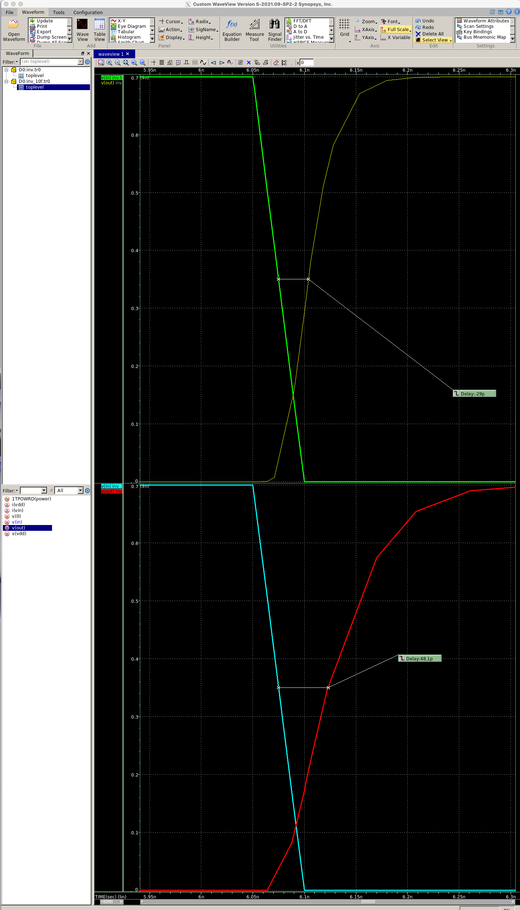
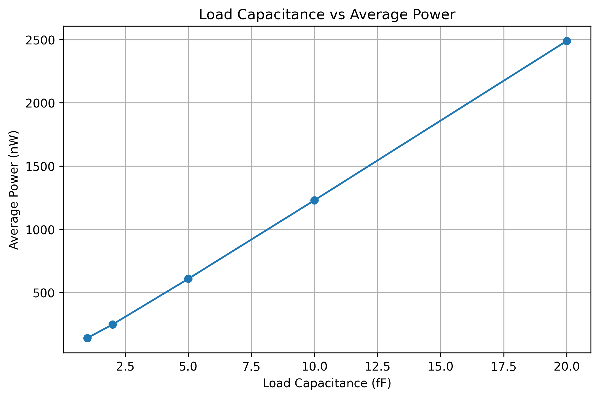
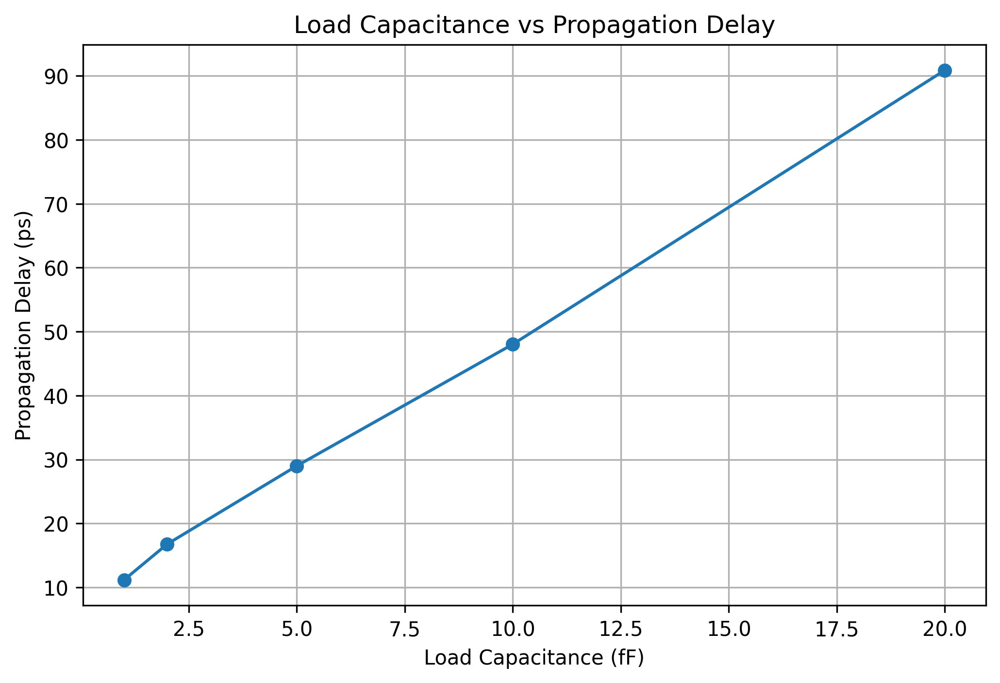

# CMOS Inverter Simulation & Analysis

## 1. Overview

This project explores the behavior of a CMOS inverter using Synopsys HSPICE.

The main objective is to investigate how output load capacitance affects propagation delay and average power consumption.

I also practiced Python automation to generate circuit simulations, run HSPICE, and collect measurement results.

## 2. Tools & Technologies

- **Synopsys HSPICE** — Circuit simulation
- **Synopsys WaveView** — Waveform analysis
- **Python** — Simulation automation and data processing
- **Matplotlib** — Data visualization
- **Linux** — Simulation environment

## 3. Simulation Setup

The CMOS inverter was simulated using 7nm transistor models.

| Parameter | Value |
|---|---|
| Supply Voltage | 0.7 V |
| Transient Simulation | 10 ns |
| Load Capacitance | 1, 2, 5, 10, 20 fF |
| Delay Measurement | Input falling → Output rising |
| Delay Threshold | 50% of VDD (0.35 V) |

## 4. Initial Experiment

I first simulated the CMOS inverter with 5 fF and 10 fF load capacitances.

Propagation delay was measured manually using WaveView.

| Load Capacitance | Propagation Delay | Average Power |
|---|---|---|
| 5 fF | ~29 ps | 617.7 nW |
| 10 fF | ~48.1 ps | 1277.4 nW |

### Waveform Comparison



Increasing the load capacitance increased both propagation delay and average power consumption.

## 5. Python Simulation Automation

After completing the manual experiments, I developed a Python workflow to automate the simulation process.

The automation workflow:

1. Reads an existing SPICE netlist.
2. Generates new netlists with different load capacitances.
3. Executes HSPICE simulations using Python's `subprocess` module.
4. Extracts average power and propagation delay measurements from the simulation output.
5. Saves the results to a CSV file.

Propagation delay was measured using HSPICE `.meas` commands and the 50% voltage crossing points.

The HSPICE automation scripts were run on the university lab server. This repository currently includes the plotting script and exported measurement results.

## 6. Automated Simulation Results

| Load Capacitance | Average Power (nW) | Propagation Delay (ps) |
|---|---|---|
| 1 fF | 141.4831 | 11.1613 |
| 2 fF | 248.4034 | 16.7697 |
| 5 fF | 609.3238 | 29.0046 |
| 10 fF | 1230.0 | 48.0310 |
| 20 fF | 2489.3 | 90.8889 |

### Average Power vs. Load Capacitance



### Propagation Delay vs. Load Capacitance



Both average power and propagation delay increased with load capacitance under the simulated conditions.

## 7. Data Analysis

The plotting script is located at:

`analysis/plot_results.py`

The simulation data is stored in:

`results/full_results.csv`

To regenerate the graphs, install Matplotlib and run the following command from the repository root:

```bash
python3 hspice/cmos-inverter/analysis/plot_results.py
```

The script reads the CSV data and saves both graphs in the `images` directory.

## 8. Validation Notes

The automated delay measurements closely matched the manual WaveView measurements:

- **5 fF:** approximately 29 ps (manual) vs. 29.0046 ps (automated)
- **10 fF:** approximately 48.1 ps (manual) vs. 48.0310 ps (automated)

A small difference was observed between the initial power-only simulations and the later simulations that included delay measurements.

For example, the 5 fF average power changed from 617.6961 nW to 609.3238 nW. This difference was reproducible, but its underlying cause has not yet been determined.

The two measurement datasets are therefore preserved separately.

## 9. Conclusion

This project helped me understand the effects of load capacitance on CMOS inverter timing and power consumption.

I also gained hands-on experience with circuit simulation, Linux, Python automation, waveform analysis, and data visualization.
